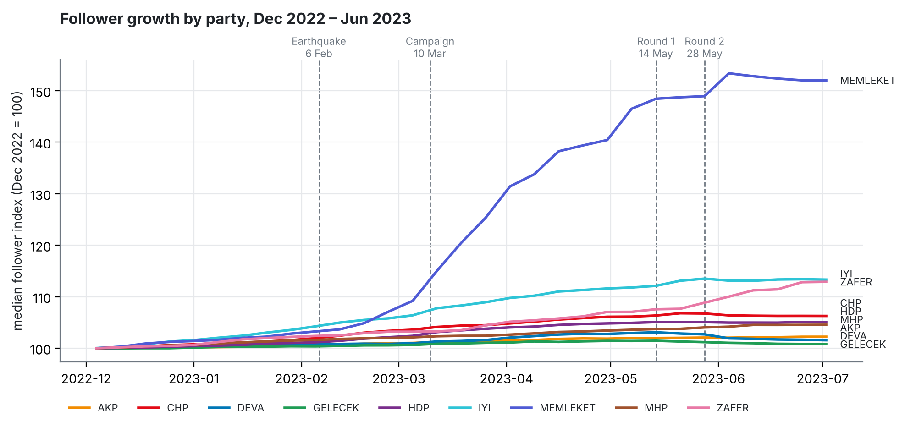
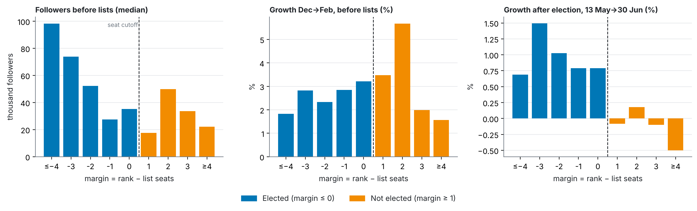
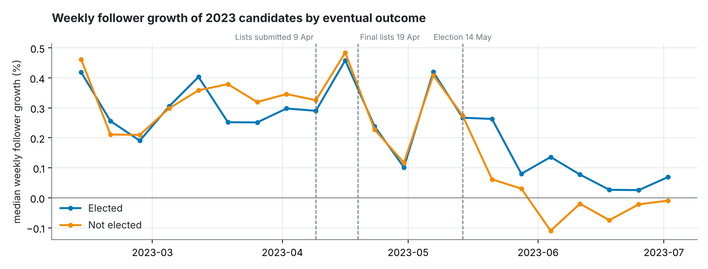
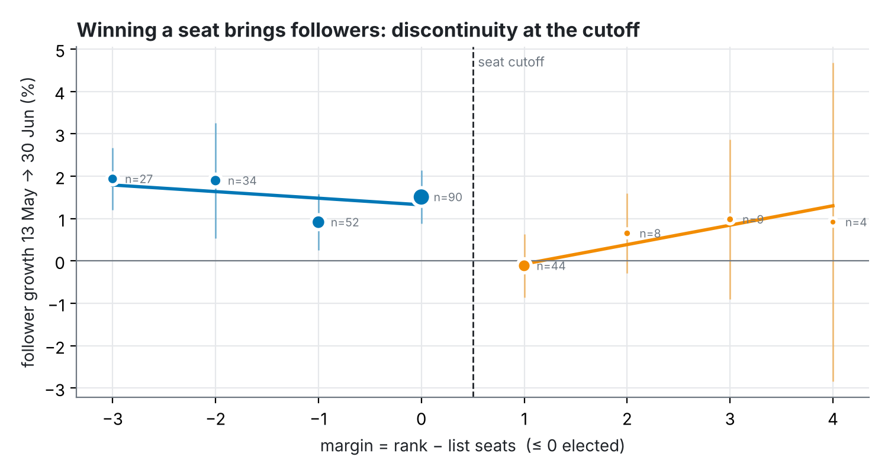

# Do Followers Win Seats — or Do Seats Win Followers?
### Twitter attention, party list ranks and the 2023 Turkish parliamentary election

**DSA 210 – Introduction to Data Science · Fall 2026-27 · Sabancı University**
**Author:** Mehmet Armut · **Data:** [#Secim2023](https://doi.org/10.7910/DVN/QJA1ZW) (ViralLab, Sabancı University) + official 2023 candidate lists + elected MPs

> **Status:** ✅ project idea · ✅ data collected · ✅ exploratory analysis ([01](notebooks/01_eda.ipynb), [02](notebooks/02_candidates_and_seats.ipynb)) · ⏳ formal hypothesis tests · ⏳ machine learning · ⏳ final report

---

## 1. Motivation

Politicians who won a seat on 14 May 2023 had more Twitter followers and grew faster than those who did not. The tempting
reading is *"online attention wins votes."* But Türkiye elects its parliament with **closed party lists**: a candidate wins
**if and only if their rank on the list ≤ the number of seats their list wins in the district**. Inside a list, voters cannot
pick a person — the party already did, when it set the ranks.

That turns one vague question into three testable ones:

1. **Selection** — do parties give electable ranks to politicians who are big or rising on Twitter?
2. **Anticipation** — once lists are public, do candidates in "safe" slots start gaining followers faster?
3. **Seat effect** — comparing candidates *just inside* and *just outside* the seat cutoff, does **winning a seat itself** bring followers?

The cutoff in (3) is decided by how many votes the *whole list* got in the district, which an individual candidate barely
controls — a natural experiment (regression-discontinuity design) that is only possible because of the closed-list rule.

## 2. Data

| Source | Content | Role |
|---|---|---|
| **#Secim2023 profile snapshots** — Harvard Dataverse `profiles/` (12 monthly files) | ~424k daily snapshots (followers, friends, tweets…) of 934–1,714 political accounts, Jul 2022 – Jun 2023 | Twitter attention over time |
| **#Secim2023 account list** — [ViralLab GitHub](https://github.com/ViralLab/Secim2023_Dataset) | party, role and province of each account | party labels |
| **Official final candidate lists** — [Resmî Gazete, 19 Apr 2023, No. 32168 (Mükerrer)](https://www.resmigazete.gov.tr/eskiler/2023/04/20230419M1-1.pdf) | every candidate's **district, party, list rank**, education, occupation | **built for this project:** the 422 pages are scanned images, so they were OCR'd (tesseract, Turkish) and parsed → **12,992 candidates, 87 districts, 24 parties + independents** ([`src/ocr/`](src/ocr)) |
| **28th-term MPs** — [Turkish Wikipedia](https://tr.wikipedia.org/wiki/TBMM_28._d%C3%B6nem_milletvekilleri_listesi) | the 600 MPs elected on 14 May 2023 | outcome |

**Data quality checks.** 573 of 600 elected MPs are found on the OCR'd lists; the rule *rank ≤ list seats* reproduces the
elected/not-elected label for **99.8%** of candidates; 638 #Secim2023 accounts are linked to a 2023 candidacy (565 on
seat-winning lists form the analysis sample).

## 3. Hypotheses

`margin = list rank − seats won by the list in the district` → margin ≤ 0 elected, margin ≥ 1 not elected.

| | H₀ | H₁ | Test |
|---|---|---|---|
| **H1** Party differences | Campaign follower growth has the same distribution across parties | at least one party differs | Kruskal–Wallis + Dunn post-hoc |
| **H2a** Selection | Pre-list Twitter size / growth is unrelated to list rank | larger / faster-growing accounts get better ranks | Spearman within list; logistic regression for an electable slot with party & district controls |
| **H2b** Anticipation | After lists are published, electable and non-electable candidates grow at the same rate | electable candidates accelerate | difference-in-differences (person & week fixed effects) |
| **H2c** Seat effect | No discontinuity in post-election follower growth at the seat cutoff | winners gain more | regression discontinuity (local linear, several bandwidths) + placebo on pre-election growth |

**Machine-learning stage:** predict whether a candidate gets an electable slot from information available *before* the
lists (Twitter size, growth, activity, account age, incumbency, party, district magnitude) with logistic regression and
gradient boosting; compare cross-validated ROC-AUC with and without the Twitter features to measure how much online
attention adds to what the party structure already explains.

## 4. First findings

### Online attention and votes can diverge


The median Memleket Partisi account grew ~50% between December and June — far ahead of every other party — yet the
party won no seats. Campaign growth differs strongly across parties (Kruskal–Wallis H = 136, p < 10⁻²⁴; [notebook 01](notebooks/01_eda.ipynb)).

### Placement follows size, not momentum — and seats bring followers


- **H2a (selection):** candidates in electable slots had about **twice as many followers** before the lists (median 41k vs 21k,
  p < 10⁻⁶); within AKP (ρ = −0.35, p < 0.001) and YSGP (ρ = −0.52, p < 0.01), more followers ↔ better rank. But **recent growth
  did not differ** overall (2.65% vs 2.83%, p = 0.70): parties mostly rewarded established accounts, not rising ones —
  CHP is the one exception worth testing (faster growers ranked higher, ρ = −0.26, p = 0.01).
- **H2b (anticipation):** no extra growth for safe-slot candidates between list publication and election day (p = 0.63).



The two groups move in parallel through the whole campaign and **separate only after election day**.



- **H2c (seat effect):** at the cutoff, winners' follower growth (13 May → 30 Jun) jumps by **+1.5 to +2.5 percentage points**
  (95% bootstrap CIs exclude zero for bandwidths 2, 3 and 4). The same design on *pre-election* growth shows **no jump**
  (placebo CIs include zero) — the gap appears only once the seat is won.

**Preliminary answer: seats win followers, more than followers win seats.** ([notebook 02](notebooks/02_candidates_and_seats.ipynb))

## 5. Repository structure

```
├── data/
│   ├── raw/          # #Secim2023 profile snapshots + account list (as downloaded)
│   ├── external/     # candidates_2023.csv (OCR'd official lists), 28th-term MP list
│   └── processed/    # daily panel (split by year), accounts, features, candidates_linked (built by src/)
├── figures/          # all charts in this README
├── notebooks/
│   ├── 01_eda.ipynb                     # accounts, parties, events
│   ├── 02_candidates_and_seats.ipynb    # list ranks, selection, anticipation, RD at the seat cutoff
│   └── make_*_notebook.py               # source of the notebook cells
├── src/
│   ├── download_data.py      # fetch #Secim2023 files from Harvard Dataverse
│   ├── build_dataset.py      # raw JSON -> daily panel, accounts, growth features
│   ├── build_candidates.py   # candidates <-> elected MPs <-> Twitter accounts, margin to cutoff
│   └── ocr/                  # Resmî Gazete PDF -> candidates_2023.csv (tesseract + parsing)
└── requirements.txt
```

## 6. Reproduce

```bash
pip install -r requirements.txt
python src/download_data.py          # optional: raw files are already in data/raw
python src/build_dataset.py
python src/build_candidates.py
jupyter nbconvert --to notebook --execute --inplace notebooks/01_eda.ipynb notebooks/02_candidates_and_seats.ipynb
# optional, rebuild the candidate table from the PDF (needs tesseract-ocr-tur): bash src/ocr/run_ocr.sh
```

## 7. Limitations

- **Sample:** #Secim2023 tracks accounts chosen before the election (mostly incumbents and party officials), so first-time candidates are under-represented.
- **OCR & name matching:** ~1.5% of candidate rows were lost in OCR; official lists use full legal names, so matching uses ordered-token rules and drops ambiguous cases. A few common names may still be mislinked.
- **Followers ≠ approval:** follower counts measure attention and include bots (documented in the #Secim2023 paper).
- **Alliances:** small parties (DEVA, Gelecek, Saadet, DP; HDP via YSGP) ran on partners' lists; analyses use the *list* a candidate ran on.
- **Snapshot gaps** (e.g. late May 2023) mean daily gains are "change since the last snapshot".

## References

- Najafi, A., Mugurtay, N., Zouzou, Y., Demirci, E., Demirkiran, S., Karadeniz, H. A., & Varol, O. (2024). *First public dataset to study 2023 Turkish general election.* Scientific Reports, 14, 8794. https://doi.org/10.1038/s41598-024-58006-w
- Dataset: https://doi.org/10.7910/DVN/QJA1ZW · Code: https://github.com/ViralLab/Secim2023_Dataset
- Yüksek Seçim Kurulu, Decision 2023/643 — 28th-term final candidate lists, Resmî Gazete 19.04.2023, No. 32168 (Mükerrer).
